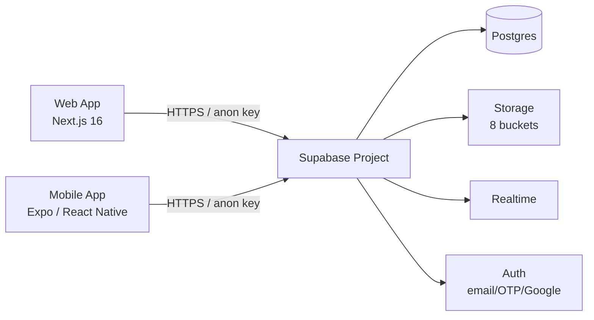
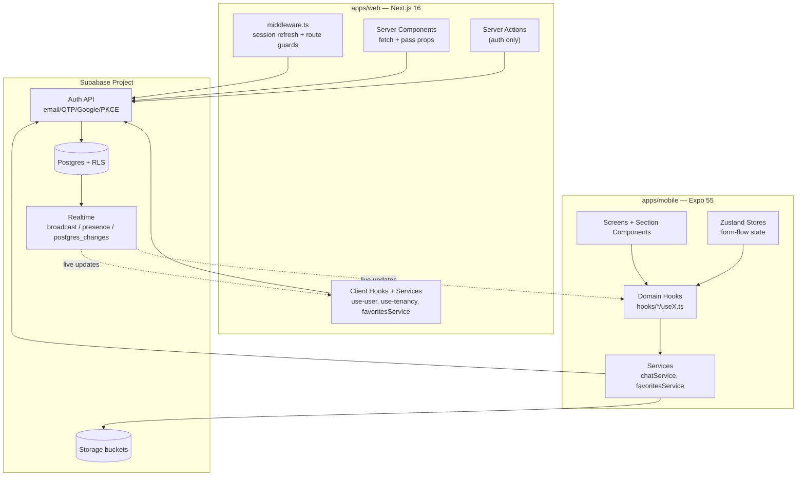
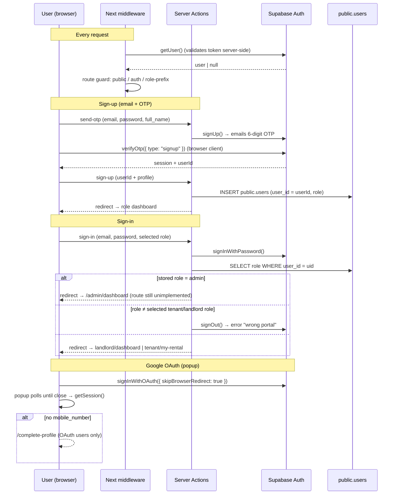
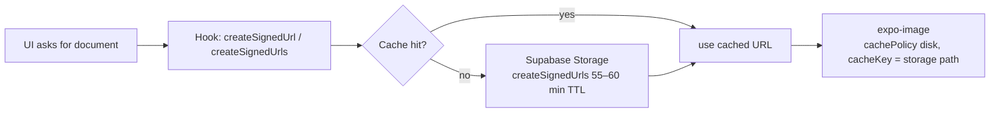
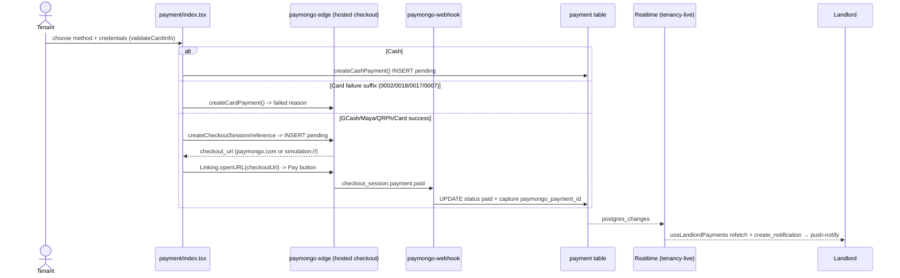
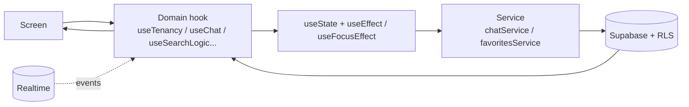
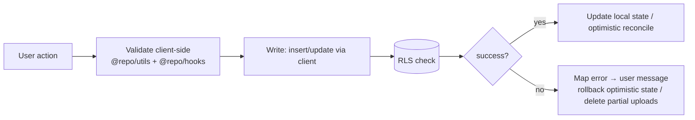

# ARCHITECTURE.md — APT (A Place to Thrive)

The authoritative description of how APT works as a software system: how the repository is organized, how data flows, how the platform's subsystems (auth, payments, chat, storage, realtime) work, and where new features should integrate.

Document hierarchy:

| Document | Scope |
|---|---|
| **ARCHITECTURE.md** (this file) | How the system works — structure, flows, subsystems |
| **AGENTS.md** | Engineering conventions — how to write code here |
| **DESIGN.md** | Visual design — how the UI should look |
| **design-tokens.json** | Design tokens consumed by the apps |

Every architectural claim in this document was verified against the repository at the time of writing. Where a claim could not be verified — or does not exist — it is explicitly marked **Not currently implemented** or **Could not be verified**. This document describes the system as it is, not as intended; planned behavior is confined to §7.2 and §22 and is always labeled.

---

## 1. System Overview

APT is a rental management platform for the Philippine market (CAMANAVA area focus). It connects **tenants** (students and renters) with **landlords** (property owners): tenants browse listings, apply, visit, chat, pay rent, and file maintenance requests; landlords publish units, manage applications, visits, payments, and maintenance. The web admin portal reviews account/property verifications, moderates account access and listing visibility, and reports aggregate metrics. Admin promotion remains a trusted database-operator action.

Admin operations run through server actions and constrained database functions, with the Auth ban/unban performed by a service-role Edge Function. Account suspension revokes refreshable sessions; restrictive table/storage RLS blocks data access from already-issued JWTs until expiry. Listing visibility is independent of apartment availability and deletion; tenant discovery filters hidden listings while owner/admin reads and existing tenancy records remain accessible. See `docs/plans/phase-2-admin-portal.md` for the rollout and acceptance matrix; Phase 2's migration and Edge Function require an approved production deployment.



**Architectural style.** Backend-as-a-service. There is **no custom application server**: both clients speak to Supabase directly (PostgREST, Auth, Realtime, Storage). Authorization is enforced database-side via Row Level Security (RLS); the clients use only the public anon key. There are no API routes on web (`apps/web/app/api/` does not exist). The repo does track one Edge Function (`supabase/functions/push-notify`) and a `supabase/migrations/` folder holding the notification schema only — most schema remains cloud-only (see §5 and debt D17).

**Major technologies.**

| Layer | Technology |
|---|---|
| Web | Next.js 16 (App Router), React 19, Tailwind CSS v4, HeroUI v3 + shadcn/ui, Leaflet |
| Mobile | Expo 55 (React Native 0.83), Expo Router, Uniwind, HeroUI Native v3, Zustand |
| Backend | Supabase: Postgres, Auth (PKCE), Realtime, Storage |
| Monorepo | pnpm 10 workspaces (`apps/*`, `packages/*`), Node 22 |

**Users and platforms.**

| User | Web | Mobile |
|---|---|---|
| Tenant | browse, favorites, my-rental (view-only), messages | full tenant experience (search, apply, visit, pay UI, maintenance, chat) |
| Landlord | dashboard (dummy data), properties CRUD, messages | full landlord experience (units, applications, visits, maintenance, analytics, chat) |
| Admin | not implemented (role exists in middleware only) | — |

---

## 2. Repository Structure

```text
apt-rental-platform/
├── apps/
│   ├── web/        # Next.js 16 marketing + product UI
│   └── mobile/     # Expo 55 React Native app (iOS/Android)
├── packages/
│   ├── constants/  # Domain constants + PH address data (@repo/constants)
│   ├── hooks/      # Shared React validation hooks (@repo/hooks)
│   ├── supabase/   # Supabase clients + generated DB types (@repo/supabase)
│   └── utils/      # Shared pure utilities (@repo/utils)
├── supabase/       # Supabase CLI artifacts ONLY (.temp/) — no migrations
├── graphify-out/   # Knowledge graph for AI navigation (see §24)
├── AGENTS.md       # Engineering conventions
├── DESIGN.md       # Visual design system
└── design-tokens.json
```

**Monorepo philosophy.** Shared, platform-agnostic logic lives in `packages/`; anything platform-specific stays inside `apps/`. Apps may depend on packages; packages never depend on apps. There is no shared UI package — components are duplicated per platform by design (DESIGN.md governs visual parity).

**Why each package exists.**

| Package | Exists because |
|---|---|
| `@repo/supabase` | Both apps need Supabase clients with **different session storage** (cookies on web, AsyncStorage on mobile) plus one generated type source for the database (`Database`) so queries are type-checked on both platforms |
| `@repo/constants` | Domain values (apartment types, payment statuses, PH provinces/cities/barangays, postal codes, user attributes) must be identical across platforms and are far too large to duplicate |
| `@repo/utils` | Pure formatting/validation (PHPeso display, PH addresses, card validation, relative time) reused by both apps |
| `@repo/hooks` | Validation hooks for PH phone numbers, postal codes, and password strength — duplicated logic that started on mobile and is available to web |

**Notable absences.** No `apps/web/app/api/` routes, no `supabase/migrations/`, no `supabase/functions/`, no tests, no CI, no formatter config. The database schema lives only in the linked Supabase project; the repo's reference for it is the generated types in `packages/supabase/src/types.ts`.

---

## 3. High-Level Architecture



**Web.** Next.js middleware (`apps/web/middleware.ts`) delegates to `@repo/supabase/middleware` (`updateSession`): it refreshes the session cookie and enforces route guards on every request. Server pages fetch data with `@repo/supabase/server` and pass plain props to `"use client"` children. Mutations are rare: the only server actions are the auth actions in `app/(auth)/actions/` (including password recovery). All other reads/writes run client-side through `@repo/supabase/browser` (a singleton `createBrowserClient` from `@supabase/ssr`), trusting RLS.

**Mobile.** Screens compose section components; domain hooks (`hooks/<domain>/useX.ts`) own fetching/state; `service/chatService.ts` and `service/favoritesService.ts` are stateless Supabase operations. Zustand stores hold only multi-step form-flow state (see §11). All Supabase access goes through the `@repo/supabase` default client, which branches between React Native (PKCE + AsyncStorage) and web environments.

**Interaction with services.**

| Service | Used by | Purpose |
|---|---|---|
| Postgres + RLS | both | All business data; final authorization authority |
| Auth | both | Sessions, email/OTP signup, Google OAuth, PKCE |
| Realtime | both | Live chat delivery/typing; live payment/tenancy updates |
| Storage | both | Images, lease agreements, documents, chat attachments |

---

## 4. Authentication Architecture

### 4.1 Stack

| Aspect | Web | Mobile |
|---|---|---|
| Client | `@supabase/ssr` via `@repo/supabase/server` / `/browser` | `@repo/supabase` default client (`packages/supabase/src/client.ts`) |
| Session storage | Cookies (HTTP-only SSR pattern) | AsyncStorage |
| Flow type | Implicit (cookie) | **PKCE** (`flowType: "pkce"`) |
| Auto-refresh | Middleware refreshes/rotates tokens on request | `autoRefreshToken: true` |
| Providers | Email/password + OTP, Google OAuth (popup) | Email/password + OTP, Google OAuth (in-app browser, PKCE) |
| Role enforcement | Middleware (route prefixes) + server pages | Bootstrap redirect (`app/index.tsx`) + `(tabs)/_layout.tsx` guard |

The mobile client (packages/supabase/src/client.ts:38) is the platform-aware one: it resolves `EXPO_PUBLIC_*` (fallback `NEXT_PUBLIC_*`) and injects AsyncStorage as the auth storage when running in React Native; `detectSessionInUrl` is enabled only outside RN (web builds). The web app is expected to use `@repo/supabase/server` / `/browser` instead (per AGENTS.md); note that `hooks/use-user.ts` and `hooks/use-tenancy.ts` currently import the root default client anyway — see §21 debt D7.

### 4.2 Identity model

Supabase `auth.users` is the canonical identity (email, password, OAuth). Each signup also creates a row in `public.users` with:

- an internal UUID primary key `id`
- `user_id` referencing `auth.users.id` (`auth.uid()`)
- `role` — `'tenant'`, `'landlord'`, or a provisioned `'admin'`
- profile fields (name, gender, birth date, mobile number, PH address, postal code)

**All RLS policies and foreign keys in the database reference the internal `public.users.id`, not `auth.uid()`.** Client code therefore resolves the internal id on every profile-dependent query:

```sql
(SELECT id FROM public.users WHERE user_id = auth.uid())
```

Both platforms resolve this in hooks: `users.select(...).eq('user_id', user.id)` (e.g. `apps/mobile/hooks/auth/useProfile.ts`, `apps/web/hooks/use-user.ts`).

Phase 0 admin authorization hardening: browser/mobile profile edits cannot change `role` or `account_status`; registration can create only tenant/landlord profiles with unverified status. New Google users may choose a tenant/landlord role only while their profile is incomplete via the caller-bound `set_onboarding_role()` RPC. Admin assignment is an operator-only database change (`docs/admin-provisioning.md`). The admin UI itself is not yet implemented.

### 4.3 Web flow



Key files: `apps/web/app/(auth)/actions/{send-otp,sign-up,sign-in,sign-out,complete-profile,check-email-availability,add-role,update-profile,password-recovery,change-password,change-email}.ts` (the only server actions in the app), `apps/web/app/auth/callback/route.ts` (OAuth code exchange; handles `popup=true`, the onboarding-role RPC, provisioned-admin redirect, and the `/complete-profile` branch), `apps/web/app/(auth)/sign-up-form/hooks/useOtpFlow.ts` (browser-side OTP verify with 120s resend cooldown).

**Route guards** (packages/supabase/src/middleware.ts): a public-route allowlist (note: includes `/help`, `/contact`, `/safety`, `/faq` for which no routes exist — debt D12); signed-out users on non-public routes → `/sign-in`; signed-in users on `/sign-in`, `/sign-up`, `/sign-up-form`, `/forgot-password` → `/`; role-prefix protection maps `tenant → /tenant`, `landlord → /landlord`, `admin → /admin` and redirects to the user's own first route on mismatch. Server actions bypass middleware (`next-action` header check). `auth/users` row queries in middleware run through RLS.

**Password recovery (2026-10-13).** Web mirrors the mobile 6-digit code flow (§4.4) with server actions in `app/(auth)/actions/password-recovery.ts`, so the recovery session lives in the normal Auth cookies. `/forgot-password` holds the email and code steps on one page (the email stays in component state, never the URL); `/forgot-password/reset-password` sets the new password; `/forgot-password/updated` is the signed-out success page. Before `verifyOtp({ type: "recovery" })` the action sets the HTTP-only `apt-password-recovery` marker cookie, holding the start time. It lasts 400 days like the `@supabase/ssr` Auth cookies, so a recovery session can never outlast it and turn into a normal one; a recovery older than 30 minutes counts as abandoned. The middleware runs `recoveryRouteDecision` (`@repo/supabase/password-recovery`, pure, tested in `apps/web/lib/password-recovery.test.mjs`) before every other rule: a marked session may use only the reset page, and any other page load signs this browser out (to `/forgot-password` inside the flow, `/sign-in` elsewhere); a marker without a session is cleared. Background requests (`Sec-Fetch-Dest` other than `document`, or `Sec-Purpose: prefetch`) are answered 204 instead, because Next.js strips its own router headers before the middleware and a prefetch must never end a reset; for a real client-side navigation the 204 makes Next.js fall back to a full page load, which gets the real decision. Sign-out redirects copy `supabaseResponse` cookies (a fresh `NextResponse.redirect` drops them) and expire the Auth cookies directly as a backstop. Server actions skip the middleware, so `updateRecoveredPassword` re-checks the marker and user itself; on success it signs out `global` and calls `redirect()` to the success page (Cancel redirects to `/sign-in` the same way). A server-action `redirect()` rejects the client's promise with Next's redirect signal, so the reset form calls these actions inside a transition and passes the signal on with `unstable_rethrow`. Ending the session sets cookies, which makes Next re-render the current page inside the action response; the reset page therefore renders a "session ended" view instead of redirecting when the session is gone (page loads are already redirected by the middleware). On `popstate` the reset page reloads, because back/forward can restore a cached page without a request; the reload is a real page load the middleware signs out. A successful password sign-in clears any leftover marker. Recovery responses from the middleware carry `Cache-Control: private, no-store`; the pages are `force-dynamic`. Google-only accounts are detected only after verification and signed straight out. The marker is a journey guard, not a security boundary: the inbox owner already controls the account, and the session can technically call anything a normal session can.

**Password change (2026-10-13).** Tenants and landlords change their password from Settings → Security, mirroring mobile (§4.4). The admin Security tab is unchanged. The Change Password row closes the Settings modal and opens a separate `ChangePasswordModal` (`app/components/settings/`; its open state lives in `SettingsOverlay`, not a route or query param), so passwords never reach a URL. The modal clears them whenever it closes and cannot be dismissed while a change is in flight. On success it shows a toast and replaces the form with a "Password Updated" confirmation inside the same modal, like forgot-password's success page. The confirmation email is Supabase's `password_changed` security notice (§4.5). Supabase sends it on every password change, so the app sends no email of its own. `usePasswordSignInStatus` (`hooks/use-password-sign-in-status.ts`) enables the row only for accounts with an `email` identity. Google-only accounts see it disabled with a "Signed in with Google" chip. Signed-out visitors (Settings on a public page) get a disabled row and no error. The server action `changePassword` (`app/(auth)/actions/change-password.ts`) refuses while a recovery marker is present, because server actions skip the middleware and the recovery session has its own reset page. It then runs `changePasswordWith(supabase.auth, …)` from `@repo/utils`, the same steps mobile runs. It returns only a `PasswordErrorReason`, and the form places that reason with `getPasswordChangeErrorField`. Verifying the current password rewrites the Auth cookies for the same user, so Next re-renders the page in the action response. The modal is client state and survives that. There is no `redirect()`, so the form needs no `unstable_rethrow`.

**Session context.** There is **no global session React context** on web. `app/(auth)/components/AuthContext.tsx` is a form-state context scoped to the `(auth)` route group (type, role, email, password, error, loading). Session awareness comes from `hooks/use-user.ts` (auth user + profile, subscribes to `onAuthStateChange`) and from server pages calling `getUser()` directly.

**Change email (2026-10-15).** Tenants and landlords change their email from Settings → Security, mirroring mobile (§4.4). Only email/password accounts without Google are eligible (`isEligibleForEmailChange`; Google and linked accounts see a disabled "Signed in with Google" row, and the service/server layers recheck). The Change Email row closes the Settings modal and opens a separate `ChangeEmailModal` (state in `SettingsOverlay`, never a route or query param; a request step, then one code step per inbox laid out like password recovery, using the shared `app/components/inputs/CodeInput`); emails, passwords and codes are cleared whenever it closes. The actions in `app/(auth)/actions/change-email.ts` refuse recovery-marker sessions (server actions skip the middleware) and suspended accounts, then run the shared `@repo/utils` `emailChange.ts` sequence: `signInWithPassword` with the canonical Auth email, `updateUser({ email })`, one 6-digit `verifyOtp({ type: "email_change" })` per inbox (the form names the inbox; the address comes from Auth, and an accepted code is used up so a confirmed inbox is never re-sent), one resend for both inboxes (Supabase keys it by the current address and reissues both codes), completion confirmed only by re-reading Auth (`user.new_email` cleared / canonical address equals the intended one), profile sync through the caller-bound `sync_my_profile_email()` RPC, then `signOut({ scope: "others" })`. `public.users.email` is server-managed (migrations `20261014160356_protect_profile_email_and_sync` + `20261014174610_restore_self_service_profile_update_grants`; revoking table-wide UPDATE also drops column grants, so the editable columns are re-granted): clients lost UPDATE(email), a trigger rejects direct email writes and signup inserts that differ from the Auth address (so both sign-up flows insert the Auth user's own lowercased `email`, never the typed value), and only the definer sync function copies the committed Auth address. The email-change confirmation (`email_change`, both inboxes) and `email_changed` security notice live in `supabase/templates/` (§4.5).

### 4.4 Mobile flow

**Portal selection (2026-09-30).** A mobile profile's `users.roles` array supplies tenant/landlord membership. `service/auth/portalPreference.ts` stores only a per-auth-user portal choice in AsyncStorage; `stores/usePortalStore.ts` keeps its in-memory active value. Sign-in has no role selector: returning accounts resume their last authorized portal, falling back to a held tenant/landlord role. Sign-up selects a role; Google sign-in with an incomplete profile offers role choice on `auth-complete-profile` before the onboarding RPC runs. On sign-out, in-memory state and sensitive query data clear but the account-scoped choice remains. Bootstrap revalidates the saved choice against current roles, and the `(tabs)` guard redirects only when the current tab group differs from the active authorized portal. Both profile screens show a switch for dual-role users. Admin profiles have no mobile consumer access. Notification taps use the active authorized portal, not `roles[0]`.

**Profile editing.** Both mobile profile tabs open `/edit-profile`, which loads `useCurrentUser` and renders `components/profile/EditProfileForm` keyed only by auth account. `useEditProfile` keeps one local draft through background refetches and reuses the shared PH mobile/postal validators; names, suffix, birth date and email remain read-only. Photo selection is local until Save. `service/auth/profileService.ts` rechecks the authenticated account, compresses/uploads binary photos to unique paths in the existing public `avatars` / `background_photos` buckets, then commits the editable fields and both URLs in one `users` row update. `.select(...).single()` prevents a zero-row write from reporting success. Fresh paths preserve the previous photos if saving fails; pre-write failed uploads are cleaned, but uploads are retained after a row write with an uncertain outcome. Success patches and invalidates the exact current-user cache, shows the shared success dialog, and returns to the caller's profile on dismissal. Drafts/photos never enter route params or a store; Cancel and all back actions use the Expo Router navigation-removal guard to confirm unsaved changes and block leaving while busy. See DESIGN.md §16 for presentation.

Profile writes require explicit column UPDATE grants as well as owner-only and active-account RLS. `restore_self_service_profile_update_grants` preserves the intended profile/onboarding allowlist (including photo references, tenant preferences and `updated_at`) without a table-wide grant; Auth email, roles, verification and suspension fields remain protected. Database regression checks live in `supabase/tests/profile_update_permissions.test.sql`. Mobile failure logs use `describeAuthError`'s structural name/code/status subset so plain database error objects remain diagnosable without logging messages, details or profile data.

```mermaid
sequenceDiagram
    participant U as User
    participant S as Screen
    participant H as useGoogleAuth / hooks
    participant A as Supabase Auth (PKCE)
    participant DB as public.users

    Note over U,A: Sign-up (email + OTP)
    U->>S: complete-profile fields + password
    S->>A: signUp() → OTP email; data staged in useRegistrationStore
    U->>S: enter 6-digit code
    S->>A: verifyOtp({ type: "signup" })
    S->>DB: INSERT public.users (user_id, role, profile)
    S->>S: store.reset(); route by role

    Note over U,H: Google OAuth (PKCE + in-app browser)
    U->>H: sign in with Google
    H->>A: signInWithOAuth({ redirectTo: Linking URL auth/callback })
    H->>H: WebBrowser.openAuthSessionAsync(url, redirectTo)
    H->>A: exchangeCodeForSession(code) (deep-link listener)
    H->>DB: read role / mobile_number
    alt new user or incomplete profile
        U->>S: auth-complete-profile → update user + users row
    end

    Note over U,A: Password recovery (email + 6-digit code)
    U->>S: forgot-password: email
    S->>A: resetPasswordForEmail() → recovery-code email (same response for unknown emails)
    U->>S: enter 6-digit code
    S->>S: set AsyncStorage "recovery in progress" marker
    S->>A: verifyOtp({ type: "recovery" }) → full session
    alt Google-only account (no email identity)
        S->>A: signOut({ scope: "local" }), then show "use Google"
    else email/password account
        U->>S: reset-password: new password
        S->>A: updateUser({ password })
        S->>A: signOut({ scope: "global" }), clear marker, "Password Updated"
    end
```

**Password recovery (2026-10-13).** Email/password accounts reset by 6-digit email code; all Auth calls live in `service/auth/passwordRecoveryService.ts`. Resend calls `resetPasswordForEmail` again (`auth.resend()` does not support recovery). A verified code is a full, persisted session, so the flow never leaves one behind: leaving the reset screen signs the device out, success signs the account out everywhere, and a marker written *before* verification makes the `app/index.tsx` bootstrap sign out a reset abandoned by closing the app instead of restoring it into a portal. Google-only accounts are an app-flow rule checked after verification (checking first would reveal whether an account exists); a direct Auth call could still add a password, accepted because the inbox owner already controls the account. The email lives only in `stores/usePasswordRecoveryStore.ts`, never in route params. Hosted email templates: §4.5.

**Password change (2026-10-13).** Signed-in accounts with an `email` identity change their password from Settings (`app/settings/change-password.tsx`). Google-only accounts see a disabled "Signed in with Google" row. `service/auth/passwordChangeService.ts` passes the mobile client to `changePasswordWith` (`@repo/utils` `passwordChange.ts`, shared with web §4.3), which re-checks the current password with `signInWithPassword`, which replaces this device's session for the same user, then calls `updateUser({ password })` and ends every other session with `signOut({ scope: "others" })`. The hosted password-changed notice (§4.5) is sent automatically. The current-password check is an app-flow rule: Supabase's project-wide "require current password" setting stays off because it would also block the recovery session above. Server-side enforcement (e.g. reauthentication by email code outside recovery) is a follow-up. Both flows (and web recovery, §4.3) share `PasswordError` and `hasEmailPasswordIdentity` from `@repo/utils` (`passwordErrors.ts`, `authIdentity.ts`), plus the recovery code length, resend cooldown and email/code validation (`passwordRecovery.ts`); the mobile flows also share the `PasswordField` / `NewPasswordFields` components.

Key files: `apps/mobile/app/_layout.tsx` (crypto polyfill for PKCE via `expo-crypto`, `WebBrowser.maybeCompleteAuthSession()`), `apps/mobile/app/index.tsx` (first-launch onboarding gate + `onAuthStateChange` bootstrap that signs out an unfinished password reset, then routes by DB role), `apps/mobile/app/(tabs)/_layout.tsx` (the only role-guard layout: redirects landlord ↔ tenant tabs), `apps/mobile/hooks/auth/useGoogleAuth.ts`, `apps/mobile/stores/useRegistrationStore.ts`.

**Session handling.** Sessions persist in AsyncStorage (`persistSession: true`). The bootstrap listener in `app/index.tsx` decides landlord vs tenant entry. Deep screens (`apartment/`, `chat/`, `settings/`) are not guarded client-side; they rely on RLS server-side — unauthenticated writes fail at the database.

**User creation.** Signup (both platforms) is a two-step commit: `auth.signUp()`/`verifyOtp()` creates the auth user, then the client inserts the `public.users` row. Failure handling differs: mobile signs out if the profile insert fails (to avoid an authed-but-profiless state); web maps the unique-violation error (23505) to "account already exists". OAuth users who lack `mobile_number` are routed to a `complete-profile` screen on both platforms.

**Change email (2026-10-15).** Signed-in email/password accounts without Google change their email from Settings (`app/settings/change-email/`: the request form, then one code page per inbox, `verify-current` then `verify-new`, sharing `EmailChangeCodeScreen` and the `CodeInput` used by password recovery; addresses are re-read from Auth on each page, never passed in the route; `useEmailChangeEligibility`, Google/loading/error rows stay disabled). `service/auth/emailChangeService.ts` passes the mobile client to the shared `@repo/utils` `emailChange.ts` sequence: current-password check with `signInWithPassword`, `updateUser({ email })`, one 6-digit `verifyOtp({ type: "email_change" })` per inbox (the form names the inbox; the address comes from Auth, and an accepted code is used up so a confirmed inbox is never re-sent), one resend for both inboxes (Supabase keys it by the current address and reissues both codes), completion confirmed only by re-reading Auth, profile sync via `sync_my_profile_email()`, then `signOut({ scope: "others" })` (failures reported, not thrown). The service refuses password-recovery sessions and suspended accounts; secrets stay in screen state and clear on unmount, never in route params. The old address stays canonical until both inboxes confirm.

### 4.5 Auth emails

Supabase Auth sends all auth email through custom SMTP (Brevo). The `confirmation` and `magic_link` templates (signup / sign-in code), `recovery` (password-reset code), `email_change` (email-change code, sent to both the current and new inbox under Secure Email Change) and the `password_changed` / `email_changed` security notices live in `supabase/templates/` and are mirrored in `supabase/config.toml` for local development; `[auth.email]` there mirrors the hosted code length (6), expiry (300 s) and send interval (60 s, the web and mobile resend cooldown). The `recovery` email says “Enter this 6-digit code on the APT password reset screen”, so it fits both platforms. The hosted project is updated by `python3 supabase/templates/build-payload.py <out.json>` plus a Management API `PATCH /v1/projects/{ref}/config/auth` — never `supabase config push`, which would also push local-only auth settings such as `site_url`. Templates load Nunito by `<link>` from Google Fonts: embedded (base64) fonts made each email ~700 KB, past Gmail's ~102 KB clipping limit, which hid the code, and `build-payload.py` now rejects them. Hosted Auth caches templates for several minutes after an update. The Management API response includes SMTP credentials, so print only the status code.

---

## 5. Database Architecture

**Schema location.** The schema exists only in the linked Supabase project (ref `ezxirkpgfpripjydcqnt`). **There are no migrations, seed files, or DDL in this repository** (`supabase/` contains only CLI `.temp/` artifacts). The repository's de-facto schema reference is the generated type file `packages/supabase/src/types.ts` (960 lines), which defines every table, column, and foreign key. Schema changes are made directly in the Supabase dashboard/CLI against the live project, then the types are regenerated. **Exception:** the notification schema (2026-08-14 onward) is tracked in `supabase/migrations/`; the 2026-08-13 chat/image DDL (attachment URL, RPC v2, thumbs) was applied to the live DB and its migration files later removed from the repo — see debt D17.

**Tables** (from `types.ts`): `apartments`, `apartment_images`, `users`, `tenancies`, `rental_application`, `payment`, `maintenance_request`, `visit_request`, `favorites`, `reviews`, `chat` — plus the conversation RPCs (`get_portal_conversations(p_portal)` for the mobile lists; `get_conversations_v2` kept unchanged for older app builds, recorded in migration `20261014083034_record_get_conversations_v2`; v1 superseded and stripped of direct anon grants).

### 5.1 Patterns

- **Internal ID indirection.** `users` has `user_id` (→ `auth.uid()`) and internal `id` (UUID PK). Every FK — `apartments.landlord_id`, `tenancies.tenant_id/landlord_id`, `chat.sender_id/receiver_id`, `payment.tenant_id`, `favorites.tenant_id`, `reviews.tenant_id`, etc. — points at the internal `id`. Joins to `users` must disambiguate by FK name (e.g. `users!tenancies_tenant_id_fkey`) because tables often have multiple FKs to `users` (chat, reviews, tenancies).
- **RLS philosophy.** RLS is the final authority; clients use only the anon key, so every query is filtered by the user's internal id (`(SELECT id FROM public.users WHERE user_id = auth.uid())`). Individual policies are not in the repo and **could not be verified here**.
- **Soft deletes.** `apartments.deleted_at` is set instead of deleting rows; queries filter `.is("deleted_at", null)`.
- **String statuses, not enums.** Statuses (`apartments.status`, `payment.status`, application/maintenance/visit statuses) are `text` columns. Observed value usage is inconsistent across the codebase (e.g. `'paid'` vs `'not paid'`, `'pending'` vs `'Pending'`) — see §21 debt D8.
- **Read-side aggregation columns.** `apartments` carries denormalized counters (`no_favorites`, `no_ratings`, `average_rating`).
- **Chat has no conversations table.** A conversation is derived: an ordered pair of users plus `apartment_id` (nullable). Conversation lists come from the `get_conversations` RPC (see §8).
- **Payment rows are written nowhere in the codebase.** The `payment` table (amount, method, status, date, due_date, period_start/end, `reference_no`, `proof_url`) is only ever read (see §7).

---

## 6. Storage Architecture

**Buckets** — verified bucket names and their treatment in code:

| Bucket | Access | Contents | Read pattern |
|---|---|---|---|
| `apartment-images` | Public | Apartment photos | `getPublicUrl`; **inconsistently** also signed (debt D5) |
| `avatars` | Public | Profile photos | `getPublicUrl` (+ `?t=` cache-bust) |
| `background_photos` | Public | Profile background | `getPublicUrl` |
| `review-images` | Public | Review photos | `getPublicUrl` |
| `lease-agreements` | Private | Lease PDFs | `createSignedUrl(s)` |
| `application-documents` | Private | Gov ID, proof of income/billing, NBI | `createSignedUrls` |
| `chat-images` | Private | Chat images/videos/GIFs (+ thumbnails) | `createSignedUrls` (batch) |
| `maintenance-images` | Private | Maintenance photos | `createSignedUrls` |

### 6.1 Path conventions

| Bucket | Pattern | Writes |
|---|---|---|
| `apartment-images` | `{apartmentId}/{ts}-{rand}.{ext}` (web) · `thumbnails/…`, `additional/…` (mobile publish) · `apartments/{apartmentId}/cover_{ts}.{ext}`, `photo_{ts}.{ext}` (mobile manage) | web + mobile; `upsert: true` in manage |
| `lease-agreements` | `{apartmentId}/lease-agreement.{ext}` · `{apartmentId}/{ts}-{rand}.{ext}` (web) | web + mobile |
| `application-documents` | `{tenantId}/{applicationId}/{docKey}-{ts}.{ext}` | mobile only |
| `chat-images` | `{senderId}/{id}.{ext}` · `{senderId}/thumb-{id}.jpg` | mobile only |
| `avatars` / `background_photos` | `{userId}/{userId}.{ext}` (upsert) | mobile only |
| `review-images` | `{tenantId}/{reviewId}/{ts}-{rand}.{ext}` | mobile only |
| `maintenance-images` | `{tenantId}/{ts}-{file.name}` | mobile only |

### 6.2 Upload flow

1. Client picks/validates the asset (per-file size caps: 25 MB chat; quality/compression on pick).
2. Client **compresses** in-app (`compressImage.ts`) and uploads **binary** — base64 uploads were removed (2026-08-13, egress fix). Apartment images upload **two-tier**: a compressed `url_thumb` + full-resolution variant.
3. Client uploads directly to the bucket with the anon key (storage is RLS-protected; uploads are scoped by bucket policies).
4. Client stores **either** the storage path (private buckets) **or** a public URL from `getPublicUrl` (public buckets) in the relevant DB column; signed URLs are never persisted.
5. On failure, some flows roll back (application documents delete all uploaded files; review photos clean up; web property-create deletes the apartment row) — others do not (chat attachments, apartment publish, maintenance) — see §21 debt D9.

### 6.3 Download flow (private buckets)



- **Expiration**: signed URLs are created with 55–60 minute TTLs.
- **Caching (2026-08-13)**: private media goes through the identity-bound resolver + module cache (`privateMediaCache` / `privateMediaResolver`) — results are keyed to the current auth identity and cleared on account transition; application documents share one resolver. React Query serves as the read cache for the rest. Remaining gap: chat attachments still regenerate signed URLs on every open (debt D4). `expo-image` uses `cachePolicy="disk"` and, in chat, a `cacheKey` derived from the storage path so re-signed URLs don't re-download (ChatBubble).
- **Public buckets** are read straight from stored URLs.

### 6.4 Deletion

- Apartment photos: explicit remove on edit (web modal, mobile manage) with cover promotion.
- Lease agreements: replace = upload new → update DB → remove old; delete = null DB → remove file.
- **Property delete is a soft delete** (`deleted_at`) and **does not clean up storage** (debt D9).
- Chat attachments and maintenance images are never deleted.

---

## 7. Payment Architecture

> **PayMongo Test-Mode Hybrid (no disbursement).** Tenant selects method (GCash/Maya/QRPh/Card/Cash) → `paymongo` edge function `POST /v2/checkout_sessions` inserts `payment` `pending` + `paymongo_session_id` → returns `checkout_url` → `e-wallet-redirect` opens PayMongo hosted page via `Linking.openURL` → Pay button → deep link `?sessionId=cs_...` → `getCheckoutSessionStatus` + `paymongo-webhook` (`checkout_session.payment.paid` / `payment.paid` HMAC-verified) flips `pending` → `paid`. When `PAYMONGO_SECRET_KEY` is unset, edge function returns `simulation://` mocks (reference `-fail`/`-expired`, card `0002` etc) so local dev still works. Cash stays `pending` awaiting landlord `landlord_update_payment_status`; no payout disbursement.



**Current implementation (hybrid, no disbursement):**

| Piece | Status | Evidence |
|---|---|---|
| Mobile payment screens (method selection, card/cash forms, e-wallet redirect, success, history) | Hybrid — PayMongo hosted checkout in test mode, simulation fallback | `apps/mobile/app/tenant/payment/*` |
| Receipt generation | From persisted `payment` row by `reference_id` | `apps/mobile/app/tenant/payment/success.tsx` (`usePaymentByReference`), `components/ReceiptCard.tsx` |
| Card validation | Real (Luhn, expiry, CVV) + suffix-triggered declines | `packages/utils/src/validateCardNumber.ts`, `service/payments/paymongoService.ts` |
| E-wallet redirect | `Linking.openURL(checkoutUrl)` + `getCheckoutSessionStatus` verify + deep-link handler | `apps/mobile/app/tenant/payment/e-wallet-redirect.tsx` |
| Payment history (mobile) | Real rows via `fetchPayments(tenancyId)` / `fetchPaymentById` | `service/payments/paymentService.ts`, `hooks/payments/usePayments.ts` |
| Cash flow | Inserts `pending`; landlord flips via `landlord_update_payment_status` | `service/payments/paymentService.ts:createCashPayment`, `service/landlord/landlordService.ts:updateLandlordPaymentStatus` |
| Realtime on payments | `tenancy-live` on `payment` + `tenancies` -> landlord dashboard + notifications | `apps/mobile/hooks/tenancy/useTenancy.ts` |
| Payouts / Refunds | **No disbursement** — payout tables removed; landlord profit from `payment` aggregates | — |
| PayMongo Edge Functions | `paymongo` (verify_jwt true) + `paymongo-webhook` (no-verify-jwt, HMAC) | `supabase/functions/paymongo*` |

---

## 8. Chat Architecture

There is no `conversations` table. A conversation is **an ordered pair of users plus an optional `apartment_id`** (an apartment-scoped thread is an inquiry; a non-apartment thread is a tenancy thread). Conversation metadata is served by the `get_portal_conversations(p_portal)` RPC (see §8.2a); message rows live in `chat` (`sender_id`, `receiver_id`, `apartment_id`, `message`, `message_type`, `is_read`, `read_at`, `group_id`, timestamps).

```mermaid
flowchart LR
    subgraph Mobile["Mobile (apps/mobile)"]
        MC[(chat rows)] --> LS[Chat list tabs<br/>postgres_changes chat-list:myId:portal]
        CONV[Conversation screen<br/>useChat]
        CONV --> BC[Broadcast channel<br/>chat:msg:{key}]
        CONV --> PC[Presence channel<br/>chat:presence:{key}]
    end
    subgraph Web["Web (apps/web)"]
        WC[(chat rows)] --> MSG[MessageClient<br/>unread channel tenant/landlord-unread:{id}]
        CV[ConversationView] --> PC2[presence + postgres_changes<br/>conversation:{sortedIds}]
    end
    BC -. new_message event .-> CONV
    PC -. typing .-> CONV
    PC2 -. typing .-> CV
```

### 8.1 Conversation keys

Two key formats coexist — **this is a verified inconsistency** (debt D3):

| Format | Used by | Shape |
|---|---|---|
| Realtime channel key | Mobile `useChatChannel` | `chat:{apartmentId\|'none'}:{sortedUserIds}` (IDs sorted so both sides agree) |
| RPC / route key | `get_conversations` (v1), **web** | `{otherUserId}:{apartmentId\|'none'}` |

### 8.2 Mobile conversation screen

- **Fetch (2026-08-13)**: **bounded keyset pagination** — 30-message pages, descending `created_at, id` with a strictly-older compound cursor (`chatService.fetchMessagePage`); pages merge via an ID-deduplicating helper (`chatPagination.ts`); **no unbounded selects** (debt D2 resolved).
- **Delivery**: broadcast channel `chat:msg:{key}` with event `new_message`; the sender pushes after a successful insert; receiver filters own echoes and apartment matches, and dedupes by message id. (Mobile does **not** use `postgres_changes` in the conversation screen.)
- **Channel stability (2026-08-13)**: message + presence channels are created in one effect keyed by identity `(currentUserId, otherUserId, apartmentId)`; event callbacks flow through refs so renders never churn websocket/presence channels; cleanup removes only the effect's own channel instances (`useChatChannel`).
- **Typing**: presence channel `chat:presence:{key}` keyed by user id; 2 s idle timer + 4 s heartbeat (`useChatTyping`); typing state considered fresh for 5 s.
- **Optimistic sends**: text messages get a `temp-{ts}` id and a "Sending…" bubble; replaced in place by the server row, rolled back (text restored to input) on error.
- **Attachments**: `expo-image-picker` (images/videos, 10 max, 60 s video cap); staged previews; **3-concurrent worker-pool uploads** to `chat-images` (25 MB cap); video thumbnails via `expo-video-thumbnails`; batch insert with a shared `group_id`; per-file failures filtered out; **GIFs reference the Giphy URL directly via the `url` column (`externalUrl`) — no download-then-re-upload** (debt D10 resolved); video playback failures hand off into the shared attachment retry path.
- **List**: inverted `FlatList` (newest first) with `maintainVisibleContentPosition`, auto-scroll-to-bottom within 150 px threshold, scroll-to-bottom button; history loads at the visual top edge with a loading indicator; no virtualization beyond FlatList defaults.
- **Statuses**: `is_read` boolean; **no delivered/read receipts**; `read_at` is written on web but never on mobile. Mobile marks a conversation read while it is *on screen* (chat focused and app in the foreground — `useConversationReadSync`): when it comes into view and, debounced 500 ms, as messages arrive; a pending update is flushed on leave. On-screen conversations are tracked in `conversationReadState.ts` so the list's realtime handler does not count their messages as unread.
- **Teardown**: channels removed on unmount.

### 8.2a Mobile conversation lists

- **Source**: `get_portal_conversations(p_portal)` (`'tenant' | 'landlord'`), caller from `auth.uid()`. A chat about an apartment the caller owns belongs to the landlord portal, otherwise to the tenant portal; chats with no apartment (or a missing apartment row) appear in both. This keeps dual-role users' tenant and landlord chats apart.
- **Cache**: one React Query entry per portal, `["conversations", myId, portal]`; read-state helpers update every portal's entry through the `["conversations", myId]` prefix. Realtime INSERT/DELETE merge into the cache on channel `chat-list:{myId}:{portal}`; unknown conversations (including the other portal's) trigger a refetch.
- **Row actions**: swiping a row left reveals More / Pin / Archive (`ConversationRow`); More, or holding the row (light haptic), opens `ConversationMoreSheet` (pin/unpin, archive/unarchive — disabled on the always-pinned landlord chat — mark read/unread, view profile, view apartment, mute/unmute, report, block/unblock). `useConversationRowActions` wires toasts, navigation, `ReportUserDialog` and the block `ConfirmDialog` (`ConversationActionOverlays`). Preference changes (`useConversations().updatePreferences`) and blocks (`setBlocked`) update every portal's cached list optimistically and roll back if the RPC fails.
- **Preferences** (`conversation_preferences`, one row per owner + other user + apartment|none): pinned (+`pinned_at`), archived, muted, marked unread — returned by `get_portal_conversations` and written only through `set_conversation_preference` (archiving unpins, pinning unarchives). A new message unarchives the conversation for both people (trigger), muted conversations create no notification (`notify_chat_message`), and `mark_conversation_read` (called when the chat is on screen and from "Mark as read") marks messages read and clears "marked unread".
- **Order**: pinned (tenant: current landlord first, always pinned; Pin/Archive disabled on it), separator, others (unread or marked unread first); an icon-only archive button at the top right of the "Messages" title opens `app/chat/archived.tsx` (`useConversations(portal, { subscribe: false })`, reusing the tab's realtime channel). Search also covers archived chats.
- **Block / report**: `user_blocks` (messaging only) is enforced by the `guard_chat_blocks` BEFORE INSERT trigger in both directions. `block_user` refuses while the two people share an active tenancy (any apartment, either role); `get_portal_conversations` returns `in_active_tenancy` so the sheet shows Block disabled with a note (Report and Mute stay available; Unblock is always allowed); the chat screen swaps the message box for `ChatBlockedNotice` (`useBlockStatus` → `get_block_status`). `report_user` stores a `user_reports` row (only for people the reporter has messaged; one open report per pair); admins review them at web `/admin/reports` (`admin_resolve_user_report`, audited as `USER_REPORT_RESOLVED` / `USER_REPORT_DISMISSED`).
- **Fallback**: `PGRST202` (RPC missing on the project) falls back to the legacy, non-portal-scoped list.
- **Screens**: both tabs are virtualized `FlatList`s from `react-native-gesture-handler` (so row swipes win over vertical scroll on Android) built from `buildConversationListItems`; filtering, grouping, sorting and chat route params live in `service/chat/conversationList.ts`. Search ignores surrounding spaces. The pull-to-refresh spinner reflects only a user pull (`usePullToRefresh`), and load errors show a fixed friendly message while the raw error is logged.
- **Tenant shortcut**: with an active tenancy but no conversation yet, a pinned landlord card opens a new chat about that apartment.
- **Route params**: `/chat/[conversationId]` never receives contact details; the chat screen loads the other user's phone number with their profile (`fetchOtherUserProfile`).

### 8.3 Web messages

- **Contacts & unread**: computed server-side in `page.tsx` from `get_portal_conversations` (`'tenant'` / `'landlord'`, same portal split as mobile §8.2a) plus active tenancies, which stay pinned even before any message; `lib/conversation-contacts.ts` merges them (keys `{otherUserId}:{apartmentId|'none'}`). Passed as props to the client `MessageClient`.
- **Unread badge**: `postgres_changes` INSERT on `chat` filtered `receiver_id=eq.me` on channels `tenant-unread:{id}` / `landlord-unread:{id}`. A message in a conversation the page doesn't list yet (a chat that started while it was open) triggers a debounced `router.refresh()` (`use-new-conversation-refresh`) so the server re-builds the lists. Contacts without a photo render initials (`resolveContactAvatar`); no third-party placeholder avatars.
- **Live conversation**: `postgres_changes` INSERT filtered `sender_id=eq.contact` on channel `conversation:{sortedIds}` (no apartment in the name) + presence for typing (no heartbeat).
- **Sending**: optimistic insert with `crypto.randomUUID()`; text only — **no attachments, no GIFs on web**. A refused insert (e.g. a blocked conversation) removes the optimistic message and shows the database message in an `ErrorBanner` for that conversation. Pin/archive/mute are mobile-only for now.
- **Reactions & replies (2026-10-15)**: shared `app/components/chat/` primitives (`useConversation`, `MessageBubble`, `ReactionStrip`, `EmojiPicker`, `MessageContextMenu`, `chatReactions`, `reactionEmojis`) used by both portals. Reactions persist to `chat_reactions` (PK `message_id,user_id`, so re-picking an emoji upserts and replaces the user's previous one; tapping your own emoji again deletes it) and are only allowed on persisted rows, never on `temp-`/optimistic messages. Replies write `chat.reply_to`, and each row's quoted message is resolved in a second bounded query over the page's own `reply_to` ids, falling back to an "Original message unavailable" block when the original is gone. A message's attachments still render as a text placeholder only — web has no upload path.
- **Context menu**: right-click, double-click, or long-press opens a menu per bubble (quick reactions, timestamp, Reply, Copy); a hover strip of quick reactions sits above/below the bubble depending on scroll position. The emoji picker searches by name/keyword.
- **Reaction propagation**: reactions are **not** realtime-subscribed. The conversation channel still listens to `chat` INSERT only, so another person's reaction appears on refresh or when a new message arrives, not immediately. Reaction failure rolls back through `refreshMessages()` rather than a stale local patch.
- Both tenant and landlord variants are near-identical (one file each for the shared conversation view; `browse/[apartmentId]/LandlordChatPanel` reuses the tenant `ConversationView`).

### 8.4 Attachments lifecycle (mobile only)

Web has no attachment upload or rendering path — a message carrying an attachment renders a text placeholder (§8.3).

Pick → stage (local URI preview) → upload (worker pool, `chat-images/{senderId}/{id}.{ext}` + `thumb-{id}.jpg`) → batch DB insert → batch signed URLs (60 min) → render via `expo-image` (disk cache, `cacheKey` = storage path) / `expo-video` modal. GIFs skip the pipeline entirely (external URL on the row). **Attachments are never deleted**; signed URLs are regenerated on every open (debt D4); no refresh-on-expiry while the screen stays open (debt D4).

---

## 9. Realtime Architecture

Complete inventory of every Realtime subscription in the codebase (verified — 8 unique channels, 14 event bindings):

| # | Channel | Type | Table / Event | Filter | Purpose | Where |
|---|---|---|---|---|---|---|
| 1 | `chat:msg:{key}` | broadcast | event `new_message` | client-side (own-echo skip, apartment match) | Live message delivery (mobile conversation) | `apps/mobile/hooks/chat/useChatChannel.ts` |
| 2 | `chat:presence:{key}` | presence | `sync`/`join`/`leave` | keyed by `presence.key = userId` | Typing indicators (mobile) | `apps/mobile/hooks/chat/useChatChannel.ts` |
| 3 | `chat-list:{myId}` | postgres_changes | `chat` INSERT | none (client checks membership) | Reorder/refresh conversation lists | `apps/mobile/hooks/chat/useConversations.ts` |
| 4 | `tenancy-live` | postgres_changes | `payment` INSERT/UPDATE/DELETE + `tenancies` (all events, unfiltered) | payment filtered by `tenancy_id` client-side | Live payment/tenancy updates | `apps/mobile/hooks/tenancy/useTenancy.ts` |
| 5 | `conversation:{sortedIds}` | postgres_changes + presence | `chat` INSERT (+ presence `sync`) | `sender_id=eq.contact` | Live messages + typing (web) | `apps/web/app/{tenant,landlord}/messages/components/ConversationView.tsx` |
| 6 | `tenant-unread:{currentUserId}` | postgres_changes | `chat` INSERT | `receiver_id=eq.me` | Unread badges (web) | `apps/web/app/tenant/messages/components/MessageClient.tsx` |
| 7 | `landlord-unread:{currentUserId}` | postgres_changes | `chat` INSERT | `receiver_id=eq.me` | Unread badges (web) | `apps/web/app/landlord/messages/components/MessageClient.tsx` |
| 8 | `notifications:{userId}` | postgres_changes | `notifications` `*` (INSERT/UPDATE/DELETE) | `user_id=eq.{userId}` | Feed + unread count refresh and in-app toast (feed and banner share one channel via a refcounted registry) | `apps/mobile/hooks/notifications/useNotificationRealtime.ts` |

Patterns:

- **Delivery model**: mobile chat uses broadcast (push after DB insert); web chat uses `postgres_changes`. Both require Realtime publication config in the live project (not visible in the repo).
- **Channel stability (2026-08-13)**: mobile channels are keyed by data identity (user/peer/apartment), never by render callbacks; callbacks flow through refs, so renders never churn subscriptions. Consumers share one channel per identity via refcounted registries (`useChatChannel`, `useConversations`, `useNotificationRealtime`).
- **Updates**: `UPDATE`/`DELETE` subscriptions exist only on `tenancy-live` (`*` on payment/tenancies) and the notifications `*` channel — notifications mark-read/delete events drive the feed + unread count.
- **Optimistic behavior**: chat send is optimistic with rollback (§8.2); realtime then reconciles. Payments/tenancy are not optimistic — realtime triggers a full refetch. Notifications: read-settling mutations mark-stale (`refetchType: "none"`) — the mutation's own realtime event is the single refetch trigger; the unread count updates optimistically.
- **Absent**: no storage-bucket realtime, no presence outside chat, nothing in `packages/`.

---

## 10. Shared Packages

### `@repo/supabase`

- **Exports**: `.` (default `supabase` client — RN-aware, branches PKCE/AsyncStorage vs web; plus `createBrowserClient`, `Database`, `Json` types) · `./browser` (singleton `createBrowserClient` from `@supabase/ssr`) · `./server` (`createServerClient` with Next cookies) · `./middleware` (`updateSession` — web route guards).
- **Deps**: `@supabase/supabase-js`, `@supabase/ssr`; optional peers `next`, `react-native`, `async-storage`.
- **When to use**: mobile everywhere; web server pages/actions → `./server`; web client components/hooks → `./browser`; web middleware → `./middleware`.
- **When NOT to use**: the root default export on web (per AGENTS.md it is mobile-oriented) — though `use-user.ts`/`use-tenancy.ts` still do (debt D7). Web `next.config.ts` aliases `react-native`/`async-storage` to an empty module to make the root import safe on web.

### `@repo/constants`

- **Exports**: PH address data (regions, provinces, cities, barangays, postal codes), apartment constants (types, furnished types, floor levels, lease durations, statuses, amenities, maintenance categories/urgency, payment status), user constants (gender, suffixes, valid IDs, languages, PH mobile prefixes), `COLORS`, `MONTHS`, `YEARS`, font tokens.
- **Deps**: none.
- **When to use**: any domain value or PH location option on either platform.
- **When NOT to use**: UI styling (that's `design-tokens.json` / DESIGN.md) or values that are only meaningful to one app.

### `@repo/utils`

- **Exports**: `formatPesoDisplay`, `handlePesoChange`, `formatAddress`, `formatFullName`, `formatDate`, `formatTime`, `getRelativeTime`, `getInitials`, `isValidEmail`, auth error helpers, card validation (`validateCardInfo`, Luhn, expiry).
- **Deps**: none.
- **When to use**: pure formatting/validation shared by both apps.
- **When NOT to use**: anything stateful or React-bound (that's `@repo/hooks` or app hooks).

### `@repo/hooks`

- **Exports**: `usePasswordValidation`, `usePHMobileValidation`, `usePHPostalCode`.
- **Deps**: React (peer), `@repo/constants`.
- **When to use**: mobile forms (signup, edit profile). Web declares the dependency but **never imports it** (debt D6) — validation on web lives in `sign-up-form/utils.ts` and `complete-profile.ts`.

---

## 11. State Management

| Owner | What it holds | Notes |
|---|---|---|
| **Local state** (`useState` + custom hooks) | Everything not listed below — the default | Hooks expose `{ data, loading, error, refetch }`; `useFocusEffect` refetch pattern |
| **Zustand (mobile only)** | Multi-step form-flow state | `stores/use{Registration,ApartmentForm,ApplicationForm,Personalization}Store.ts` + persisted `useThemeStore` (AsyncStorage, key `apt-theme`) |
| **Supabase** | All server data | Source of truth; fetched directly in hooks/services, never mirrored in stores |
| **URL state (web)** | Browse filters/search/pagination | `searchParams` → server page re-queries (`SearchContainer`, `FilterContainer`, `RenderApartments`) |
| **Context (web)** | Auth-form state only | `AuthContext` is scoped to `(auth)` pages; **no global session context** (see §4.3) |

Zustand stores follow `create<State & Actions>` with exported `interface`, `initialState`, and `reset()`; `reset()` is called when the flow completes or is cancelled. **React Query (mobile) is the server-state layer** (since 2026-08-13): single `QueryProvider` at the root layout, shared client in `utils/queryClient.ts` (process-memory, AppState focus bridge, `clearQueryClient()` on sign-in/out), default `staleTime` 30s, stable identity-keyed query keys (internal `public.users.id`), optimistic mutations with exact-key invalidation. Read-settling mutations mark-stale (`refetchType: "none"`) and let their own realtime event trigger the refetch. Favorites state is duplicated per consumer on web (each component runs its own `useFavorites`) and single-source in the mobile hook.

---

## 12. Feature Architecture

Each feature below is mobile-first; the web mirrors it where noted. "Architecture only" — no UI details.

| Feature | Mobile | Web | Backing tables |
|---|---|---|---|
| **Authentication** | §4.4 (PKCE, OTP, Google, password recovery and change), §4.5 (auth emails) | §4.3 (server actions, middleware, OAuth popup, password recovery and change) | `users` |
| **Explore / Search** | `(tabs)/(tenant)/search.tsx` — default Netflix-style discovery: `useSearchSections` (React Query) calls the `get_search_sections` RPC once for 6 horizontal sections × 8 cards, rendered lazily by viewability; `search/section/[sectionId].tsx` (See All) pages one section via `useSearchSectionPage` + `get_search_section_page` (keyset cursor, 10/page). `useSearchLogic` (debounced search, server pagination 10/page, 4 sort modes, filter sheet; estimated result count) remains the filtered/list path | `browse/` server page: full filter set, `count: exact`, 25/page, Suspense-wrapped client children | `apartments`, `apartment_images` |
| **Apartment detail** | `apartment/[apartmentId]` — sections + `useApartmentDetails` (apartment + landlord + top-3 reviews); two-tier images (compressed thumb + full) | `browse/[apartmentId]/` server page → 16 client children | `apartments`, `apartment_images`, `reviews`, `users` |
| **Rental application** | 5-step wizard (`apply/*`) with `useApplicationFormStore`, document uploads with rollback, `useSubmitApplication` | Not implemented (landlord `applications/` is a placeholder) | `rental_application`, `application-documents` |
| **Visit requests** | Tenant `request-visit` + `useSubmitVisitRequest`; landlord `visit-requests/` list/detail with actions, reschedule sheet | Not implemented | `visit_request` |
| **Tenancy / My rental** | `tenant/current-apartment.tsx` + `useTenancy` (React Query tenancy + payment reads keyed by internal id, filtered realtime scoped to the loaded tenancy, explicit refresh) | `tenant/my-rental/` client page + `use-tenancy` | `tenancies`, `payment` |
| **Payments** | Simulation (GCash/Maya/QRPh/Card = paid, Cash = pending) — §7 | Placeholder + view-only history | `payment` (tenant inserts paid/pending, landlord confirms cash) |
| **Maintenance** | Tenant request/history + `useSubmitMaintenanceRequest` (uploads photos); landlord `maintenance-requests/` workflow (pending → resolved) | Stub ("Coming Soon") | `maintenance_request`, `maintenance-images` |
| **Chat** | §8 (full: bounded 30-page history, attachments, direct-URL GIFs, typing, presence, optimistic; identity-keyed stable channels; reactions + replies + context menus; `get_conversations_v2` RPC) | §8.3 (text-only; reactions, replies, context menus, emoji search) | `chat`, `chat_reactions`, `chat-images`, `get_conversations_v2` RPC |
| **Reviews & ratings** | Detail ratings, `rate-apartment`, `useSubmitReview` (photo uploads with rollback) | Read-only display (`RatingsSection`, `RenderReviews`) | `reviews`, `review-images` |
| **Favorites** | `useFavorites` (React Query set state + DB writes, virtualized `FlatList`, caller-owned toasts) | `useFavorites` + `favoritesService` | `favorites` |
| **Landlord units** | `(tabs)/(landlord)/units.tsx`, `manage-apartment/` (edit wizard, reviews, tenant profiles), `add-apartment/` (publish wizard with `useApartmentFormStore`) | `landlord/properties/` (list, create wizard with Leaflet map, edit modals) | `apartments`, `apartment_images`, `lease-agreements` |
| **Landlord analytics** | `landlord/analytics.tsx` — React Query: single apartment-ID lookup then parallel count reads (`useDashboardStats`) | `landlord/dashboard/` — **dummy data** (debt D11) | (none) |
| **Notifications** | `(notification)/` screens (`tenant-notif` / `landlord-notif` → shared `NotificationScreen`) backed by `useNotifications` (React Query feed + unread count, both on one shared `notifications:{userId}` realtime channel via refcounted registry `useNotificationRealtime`), DB-trigger-generated rows (`create_notification`, service-role-only), Expo push via `push-notify` edge function (payload carries `notificationId`; clients mark the row read on tap/banner action), in-app HeroUI toast banner (`useInAppNotificationBanner`, realtime-driven, chat toasts suppressed while viewing that chat), role-aware deep links (`buildNotificationDeepLink`), delivery gated by per-user `notification_preferences` (master + per-type, enforced in `push-notify` and the client) | Not implemented | `notifications`, `push_tokens`, `notification_preferences` |
| **Account verification** | `verify-account/`, `document-id/` (upload screen is a stub — nothing uploads) | Not implemented | — |
| **Admin** | Not implemented | Not implemented (middleware role stub only) | `users.role = 'admin'` |
| **Profile / settings** | `profile/tenant|landlord/[id]`, `edit-profile` (avatar/background upload), `settings/*` | Not implemented (navbar links are dead — debt D12) | `users`, `avatars`, `background_photos` |

---

## 13. Navigation

### Web (Next.js App Router)

- Route groups: `(auth)` (no shared layout), `(main)` (marketing, AppNavbar + Footer), `browse` (NavbarSwitcher), `forowners`, `landlord` (SidebarProvider + LandlordSidebar), `tenant` (TenantNavbar), plus non-grouped `auth/callback` and `auth/sign-out` route handlers.
- Protection is middleware-based (see §4.3); server pages additionally resolve the user and redirect (e.g. `tenant/favorites/page.tsx` guards non-tenants).
- Dynamic segments are camelCase (`[apartmentId]`); folders kebab-case.
- URL state for filters via `searchParams`; `router.push` on the client.

### Mobile (Expo Router)

- Root `Stack` (headerless) registers index, `(tabs)`, `(auth)`, `chat/[conversationId]`, `tenant`, `apartment/[apartmentId]`, `(notification)`, `settings`, `document-id`, `edit-profile`, dev screens.
- Tabs are **platform-split**: iOS uses `NativeTabs` (SF Symbols); Android uses classic `Tabs` with a floating `CustomTabBar` (pill) whose height/bottom-offset constants are consumed by list screens for padding.
- Role tabs: `(tabs)/(tenant)` (rentals, search, chat, profile) vs `(tabs)/(landlord)` (dashboard, units, chat, profile); the `(tabs)` layout redirects to the selected portal after checking membership in `users.roles`.
- `app.json` experiments: `typedRoutes: true`, `reactCompiler: true`; scheme is `mobile` (no custom deep-link list).
- **Deep linking**: OS-level links are only for auth — `Linking.createURL("auth/callback")` for the Google PKCE exchange. **In-app** notification taps and banner actions navigate via role-aware hrefs from `buildNotificationDeepLink` (`apps/mobile/utils/notificationDeepLink.ts`) — router pushes, not OS-level links.
- Known stale registrations: `tenant/_layout.tsx` lists `current-lease` (no file exists) and `edit-profile` (actually at root) — debt D12.

---

## 14. Data Flow

### Server-driven (web pages)

```mermaid
flowchart LR
    U[User request] --> R[Next route (server)]
    R --> C[createServerClient via @repo/supabase/server]
    C --> S[(Supabase + RLS)]
    S --> D[Plain serializable data]
    D --> P[Client component props]
    P --> UI[UI]
```

Filters/params come from URL `searchParams`; pagination via `.range()`; counts via `count: "exact"`.

### Hook-driven (mobile + client web)



### Mutation flow (both platforms)



---

## 15. Error Handling

| Layer | Pattern |
|---|---|
| **Client hooks** | `{ data, loading, error }` state; mutations return `{ success, error }`; errors surfaced via `ErrorDialog`/`Dialog` + HeroUI `useToast`; `console.error` on unexpected failures (never silently swallowed) |
| **Server actions (web)** | Map Supabase error codes to friendly messages — `23505` (unique) → "account already exists"; "Invalid login credentials", "Email not confirmed", rate limits (429) |
| **Auth edge cases** | `AuthSessionMissingError` treated as signed-out everywhere (middleware, `use-user`, favorites service); mobile signs out if profile insert fails post-OTP; role-mismatch sign-in signs the user out |
| **Validation** | Client-side before every write (`validateCardInfo`, `usePasswordValidation`, `usePHMobileValidation`, `usePHPostalCode`, form utils); DB-side RLS is the final authority |
| **Optimistic failures** | Chat: temp bubble removed, text restored to input; attachments: per-file failures filtered, whole-batch failures remove all pending bubbles |
| **Upload rollback** | Application documents (delete all on any failure), review photos, web property create (deletes apartment row) |
| **Network** | No global offline/retry layer; loading and error states are kept separate; `useTenancy` degrades gracefully |

---

## 16. Security

- **RLS is the security boundary.** Both apps use only the public anon key; every data access is filtered by RLS in the live project. Policies are not visible in the repo (live project only).
- **Internal ID indirection** — FKs and policies resolve `auth.uid()` → `public.users.id`; new policies/joins must follow it (see AGENTS.md).
- **Private buckets + signed URLs** for lease agreements, application documents, chat attachments, maintenance images; paths (not URLs) are stored in DB; signed URLs are short-lived (55–60 min).
- **Secrets**: only `NEXT_PUBLIC_*` / `EXPO_PUBLIC_*` vars reach clients (Supabase URL/anon key, Giphy key). Env files are gitignored (`.env`, `.env*.local`); no secrets are tracked (`git ls-files` shows none). No payment provider secrets — simulation has no external keys (§7).
- **Input validation** client-side on all user input; server-side trust is limited to Supabase + RLS (no custom server).
- **Middleware token validation** uses `getUser()` (server-validated), never `getSession()` from cookies.

---

## 17. Performance

Verified patterns in production code:

- **Image caching**: `expo-image` `cachePolicy="disk"` across 20+ components; `cacheKey` derived from the storage path in chat so re-signed URLs reuse the cache.
- **Signed-URL caching**: module-level `Map` caches with ~55 min TTL in `useDocumentUrls`, `useLandlordMaintenanceRequests`, `useLandlordVisitRequests`, lease-agreement reads (refresh 5 min before expiry).
- **Virtualized lists**: `FlatList` for search results (grid/list switch, `onEndReached` pagination, pull-to-refresh), inverted chat list; web browse paginates server-side (25/page) with Suspense-wrapped children.
- **Lazy loading**: web `TenantNavbar` is dynamically imported; map components `React.memo`-wrapped; mobile screens mount video players on demand.
- **Pagination**: mobile search 10/page, web browse 25/page, landlord payment history limited; chat is **not** paginated (debt D2).
- **Optimistic UI**: chat sends update immediately, reconciled after insert.

Anti-patterns are documented in `docs/AUDIT_REPORT.md` (no request-dedup/caching layer, refetch storms on focus, duplicated profile resolution, signed-URL regeneration in chat) — see §21.

---

## 18. Dependency Rules

```mermaid
flowchart LR
    WEB[apps/web] --> C[@repo/constants]
    WEB --> U[@repo/utils]
    WEB --> S[@repo/supabase]
    WEB -.declared, unused.-> H[@repo/hooks]
    MOB[apps/mobile] --> C
    MOB --> U
    MOB --> S
    MOB --> H
    H --> C
    S --> SUP[@supabase/*]
```

- Apps may depend on packages; **packages never depend on apps**.
- Shared logic belongs in `packages/`; platform-specific code stays in `apps/`.
- Business logic lives in hooks/services, **not components**; mobile components never import the Supabase client directly.
- No shared UI package — platform UI is built on HeroUI (web) / HeroUI Native (mobile) with DESIGN.md as the parity contract.
- Allowed Supabase usage: mobile → `@repo/supabase` default client; web server → `@repo/supabase/server`; web client → `@repo/supabase/browser`; web middleware → `@repo/supabase/middleware` (root export on web is the known deviation, debt D7).
- No new state libraries beyond React Query (mobile) and Zustand (client-only state); no new icon libraries (three already in use — debt D14).

---

## 19. Architectural Principles

1. **Supabase is the single source of truth** for all server data — never mirror DB state in stores.
2. **RLS is the final authority** — clients hold only the anon key; UI hiding is not security.
3. **Platform parity, mobile-first** — web mirrors mobile semantics; features are usually built mobile-first.
4. **Composition over inheritance** — screens compose small section components; hooks compose services.
5. **Shared abstractions over duplication** — validation, constants, formatting live in packages.
6. **Explicit boundaries** — UI (components) / logic (hooks, services) / data (Supabase) / policy (RLS).
7. **Minimal change** — reuse → extend → share → abstract → create (AGENTS.md decision hierarchy).
8. **Internal `users.id` indirection everywhere** — FKs, policies, joins.
9. **Private data is signed, never stored as URLs** — storage paths in DB, signed on read.
10. **Optimistic where it buys UX** — chat send; conservative everywhere else.

---

## 20. AI Integration Guide

Before touching a subsystem, read its section:

| Task | Read first |
|---|---|
| Modify auth, middleware, session handling | §4 (Authentication) |
| Change schema, queries, RLS, types | §5 (Database) + AGENTS.md Supabase Conventions |
| Storage buckets, uploads, signed URLs, caching | §6 (Storage) |
| Payments | §7 (Payment) — **Current vs Planned**, §7.1 is the only reality |
| Chat, realtime channels, attachments | §8 (Chat) + §9 (Realtime) |
| Shared logic | §10 (Shared Packages) + §18 (Dependency Rules) |
| State, stores, data flow | §11 (State) + §14 (Data Flow) |
| Routing/navigation changes | §13 (Navigation) |
| New feature placement | §12 (Feature) + §18 (Dependency Rules) |
| Mobile perf/data concerns | §17 (Performance) + `docs/AUDIT_REPORT.md` |
| Anything about "how it should look" | **DESIGN.md** (not this file) |
| Code conventions, naming, structure rules | **AGENTS.md** (not this file) |

Verification workflow: run `graphify query`/`explain` for codebase questions before searching (AGENTS.md), confirm the feature's platform parity, then implement the smallest change. After edits, run `graphify update .`.

---

## 21. Known Architectural Debt

All items below are verified against the repository. The authoritative, itemized mobile audit lives in `docs/AUDIT_REPORT.md` (6 critical, 13 medium, 8 minor as of 2026-07-26); items unique to this document are marked *(this doc)*.

| # | Debt | Detail | Evidence |
|---|---|---|---|
| D1 | ~~**No data-caching/dedup layer**~~ | **Resolved 2026-08-13** — React Query adopted as the mobile server-state layer (§11); focus refetches replaced by stale-time + realtime-driven invalidation | AUDIT C1, C6 |
| D2 | ~~**Chat has no pagination**~~ | **Resolved 2026-08-13** — bounded 30-message keyset pages (§8.2) | AUDIT C3; `chatService.fetchMessagePage` |
| D3 | **Two conversation-key formats** | Mobile realtime `chat:{apt\|none}:{sortedIds}` vs RPC/web `{otherId}:{apt\|none}`; mobile conversation screen ignores the route `conversationId` | `chatService.buildConversationKey` vs web pages |
| D4 | **Signed-URL caching is inconsistent** | **Partially mitigated 2026-08-13** — private media now flows through the identity-bound `privateMediaCache`/`privateMediaResolver`; chat attachments still regenerate all URLs per open, no refresh on 1 h expiry | AUDIT C2, M3, M4, M10 |
| D5 | **`apartment-images` public/private inconsistency** | Publish stores public URLs; visit-requests signs them; detail reads raw URLs | AUDIT C5 |
| D6 | **`@repo/hooks` unused on web** | Declared in web `package.json`, never imported; validation duplicated in `sign-up-form/utils.ts` | *(this doc)* |
| D7 | **Web uses the mobile-oriented root client** | `use-user.ts`, `use-tenancy.ts` import `@repo/supabase` default (RN-aware) instead of `/browser`; requires `next.config.ts` empty-module aliases for RN deps | *(this doc)* |
| D8 | **Status values are inconsistent strings** | `'paid'`/`'not paid'`/`'Partial'`/`'Pending'` variants across code; `PAYMENT_STATUS` constants are display-level | *(this doc)* |
| D9 | **Orphaned storage objects** | Property delete is soft and never cleans storage; chat/maintenance attachments never deleted; some upload failures don't roll back (publish, chat batch) | *(this doc)* |
| D10 | ~~**GIFs re-uploaded**~~ | **Resolved 2026-08-13** — GIFs referenced by `externalUrl` on the row; no download-then-re-upload (§8.2) | AUDIT M8 |
| D11 | **Web dashboard is dummy data** | `landlord/dashboard` hardcoded; `landlord/payments` and `applications` placeholders; `tenant/maintenance` stub | *(this doc)* |
| D12 | **Dead routes & links** | Web navbar links to `/profile`, `/settings`, `/my-rental`; middleware allows `/help`, `/contact`, `/safety`, `/faq` (no routes); mobile `tenant/_layout` registers missing `current-lease`; playground links broken payment path | *(this doc)* |
| D13 | **Push requires EAS credentials** | `push-notify` edge function + `expo-notifications` are wired, but APNs/FCM credentials are not uploaded to EAS, so push delivery is unverified on devices | `eas credentials` |
| D14 | **Mixed icon/UI ecosystems** | Web: `@tabler/icons-react` + `lucide-react` + `react-icons`; mobile: `@tabler/icons-react-native` only (lucide removed 2026-08-29, 0 files; was legacy alongside Tabler) ; HeroUI + shadcn coexisting on web | AGENTS.md + *(this doc)* |
| D15 | **`public.users` role queries in middleware** | Middleware hits `users` per protected request (needs index; RLS applies) | `packages/supabase/src/middleware.ts:117` |
| D16 | **Duplicate profile resolution** | **Partially mitigated 2026-08-13** — remaining inline "auth user → users.id" resolution consolidated into shared `useCurrentUser` (React Query); web unaffected | AUDIT C4 |
| D17 | **No migrations in repo** | **Partially mitigated 2026-08-13** — `supabase/migrations/` tracks the notification schema (2026-08-14 onward, incl. 2026-08-16 policies); the 2026-08-13 chat/image DDL (attachment `url`, RPC v2, `url_thumb`) was applied to the live DB and its files removed from the repo; most schema remains cloud-only | *(this doc)* |
| D18 | **Payments are simulation** | §7 — local `payment` inserts, cash pending + simulated card declines — no provider, no webhook, no payouts/refunds | *(this doc)* |

---

## 22. Future Architecture

Mostly **Not documented** — the repository contains no architecture plans beyond the following verified signals:

- **Payments (§7)**: simulation — `payment` rows written directly by the tenant client (`paid` for e-wallet/card, `pending` for cash), landlord confirms cash, realtime drives dashboards; no provider, no webhook.
- **Admin role**: middleware maps `admin → /admin` with no routes or UI — a forward-looking stub, nothing more.
- **Audit recommendations**: `docs/AUDIT_REPORT.md` recommended adopting React Query, paginating chat, and consolidating signed-URL caching. The **audit-fix batch (merged 2026-08-13, PR #90)** implemented all three on mobile — see §11 (React Query), §8.2 (chat pagination), §6.3 (identity-bound media cache) — with specs under `.kiro/specs/audit-fix/`. Remaining audit items are tracked in §21 (D4, D5, D9, D16).
- Everything else: **Not documented.**

---

## 23. Glossary

| Term | Meaning |
|---|---|
| **Tenant** | Renter user; role `'tenant'` in `users`. |
| **Landlord** | Property owner user; role `'landlord'` in `users`. |
| **Internal user ID** | `public.users.id` — the UUID primary key used by every FK and RLS policy; distinct from `user_id` (→ `auth.uid()`). |
| **Tenancy** | Active relationship between a tenant, a landlord, and an apartment (`tenancies`); drives my-rental/current-apartment and payment display. |
| **Rental application** | Tenant's application to a unit (`rental_application`), with documents stored in `application-documents`. |
| **Visit request** | Request to view a property (`visit_request`), optionally tied to an application. |
| **Lease agreement** | PDF stored in the private `lease-agreements` bucket; DB stores its storage path (`lease_agreement_url`). |
| **Receipt** | Payment confirmation UI (GCash-style); generated from the persisted `payment` row by `reference_id` (§7). |
| **Maintenance request** | Tenant-reported issue (`maintenance_request`) with photos in `maintenance-images`; landlord resolves it. |
| **Storage path** | Object key inside a bucket (e.g. `{tenantId}/{applicationId}/{docKey}-…`); stored in DB instead of URLs for private assets. |
| **Signed URL** | Short-lived (55–60 min) authorized URL for a private-bucket object; generated on read via `createSignedUrl(s)`. |
| **Conversation key** | Identifies a chat thread; two formats exist — mobile realtime `chat:{apt\|none}:{sortedIds}` and RPC/web `{otherId}:{apt\|none}` (D3). |
| **PKCE** | Proof Key for Code Exchange — OAuth flow used by mobile sign-in (Supabase `flowType: "pkce"`). |
| **group_id** | Batch id tying multiple chat attachment rows into one visual cluster. |
| **RLS** | Row Level Security — Postgres policies that are the platform's authorization boundary. |

---

## 24. References

| Source | Relationship to this document |
|---|---|
| **AGENTS.md** | Engineering conventions: file structure, naming, hooks/stores patterns, Supabase conventions (internal-id rule, storage paths), commands, decision hierarchy. Read alongside §2, §10, §18. |
| **DESIGN.md** | Visual design system (colors, typography, spacing, components). Status markers (✅ canonical · 🚧 transitional · ⚠ legacy) describe UI state. Read for anything visual; not referenced by this document. |
| **design-tokens.json** | Machine-readable tokens consumed by the apps; source of truth for values, mirroring DESIGN.md §3–§8. |
| **graphify-out/** | Knowledge graph of the codebase (god nodes, communities, relationships). Query it (`graphify query/explain/path`) before grepping; keep current with `graphify update .`. |
| **docs/AUDIT_REPORT.md** | Itemized performance/data-flow audit of the mobile app (2026-07-26); the detailed companion to §21 D1–D10, D16. |
| **packages/supabase/src/types.ts** | Generated `Database` types — the repository's only schema reference (no migrations exist; §5). |
| **Linked Supabase project** | ref `ezxirkpgfpripjydcqnt` — live schema, RLS policies, Realtime publication config, storage bucket policies; not version-controlled (D17). |

---

*Last verified: 2026-08-01. Update this document whenever the architecture changes; claims that cannot be verified from the repository should be marked as such rather than guessed.*
