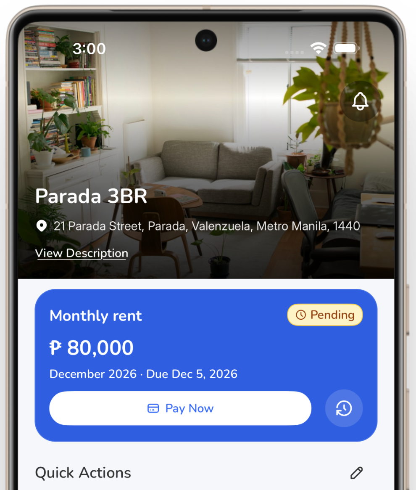

# APT — A Place to Thrive

Discover apartments, connect with property owners, and manage your rental journey in one place. APT covers verified listings across Caloocan, Malabon, Navotas, and Valenzuela (CAMANAVA).



**[Live site: apt-ph.app](https://apt-ph.app)** · [Browse apartments](https://apt-ph.app/browse) · [For owners](https://apt-ph.app/forowners) · [Download for Android](https://apt-ph.app/download)

## What is APT?

APT is a rental platform for tenants and landlords in the Philippines. Tenants browse and apply, landlords publish and manage — both on web and mobile, with verified listings and APT Passport documents attached by reference.

## How it works

1. **Discover** — Browse verified apartments and see what is available around CAMANAVA on the map.
2. **Apply** — Open a listing you like and submit a rental application with your APT Passport documents attached.
3. **Move in** — Agree terms with the owner, review the signed lease, and settle your move-in bill.
4. **Manage** — Track rent, message your landlord, and send maintenance requests through APT.

## Get the app (Android)

APT ships Android as a sideloaded APK (no Play Store). The same APK image also backs the OTA flow for JavaScript-only fixes.

1. On Android, open [apt-ph.app/download](https://apt-ph.app/download)
2. Download the APK. Allow installs from your browser once when Android asks.
3. Install over the existing app. Keep the same signing keystore — a different signature makes Android refuse the update.

Notes:

- Android arm64 only (x86 / 32-bit devices are not supported).
- Below the minimum version the app shows **Update required** and blocks until you install the latest APK.
- Native changes (new native package, permissions, `app.config.js` native fields) always need a new APK. JavaScript-only changes ship by OTA. See [docs/app-updates.md](docs/app-updates.md).

## For developers

Prerequisites:

- Node `22.17.0` (see `.nvmrc`)
- pnpm `10.34.5`
- A Supabase project (see `packages/supabase` and `supabase/`)

```bash
pnpm install
pnpm web     # apps/web — Next.js (http://localhost:3000)
pnpm mobile  # apps/mobile — Expo (pnpm --filter mobile start)
```

Per-app checks:

- Web: `pnpm --filter web lint` · `pnpm --filter web typecheck` · `pnpm --filter web test`
- Mobile: `pnpm --filter mobile lint` · `pnpm --filter mobile test`

Native note: `apps/mobile/ios/` and `android/` are generated and gitignored. After changing plugin options in `app.config.js`, run `npx expo prebuild --clean` in `apps/mobile`, then `expo run:ios` / `expo run:android` (or a new EAS build). Metro reloads do not apply native changes.

Database test suites (`pnpm db:*:test`, e.g. `pnpm db:billing:test`) are listed in [AGENTS.md](AGENTS.md).

## Repo layout

```text
apps/web       Next.js 16 web app
apps/mobile    Expo 57 mobile app (Android APK + OTA)
packages/      Shared code (@repo/constants, @repo/utils, @repo/supabase, ...)
supabase/      Migrations, Edge Functions, Auth email templates
docs/          Per-feature docs (billing, AI search, app updates, ...)
scripts/       DB test suites (db:*:test) + address / ZIP / landmarks generators
```

Not app code: `graphify-out/` (local generated knowledge graph, ignored), `patches/` (pnpm patches), `.agents/` `.junie/` `.kiro/` `.opencode/` (AI tooling), `semantic-review/` (old review notes), `supabase/.temp/` (CLI scratch).

## Documentation

| Topic | Read this |
|---|---|
| Engineering conventions, commands | [AGENTS.md](AGENTS.md) |
| System + flows (auth, payments, chat, storage) | [ARCHITECTURE.md](ARCHITECTURE.md) |
| Visual design system | [DESIGN.md](DESIGN.md) + [design-tokens.json](design-tokens.json) |
| Security policy + vulnerability reporting | [SECURITY.md](SECURITY.md) |
| Move-in billing contract | [docs/move-in-billing.md](docs/move-in-billing.md) |
| Android updates + OTA | [docs/app-updates.md](docs/app-updates.md) |
| Demo population (operator) | [docs/demo-population.md](docs/demo-population.md) |

## Security

Report vulnerabilities through GitHub private vulnerability reporting on this repository — do not open public issues. See [SECURITY.md](SECURITY.md) for scope and ground rules.

## License

ISC (see `package.json`).
